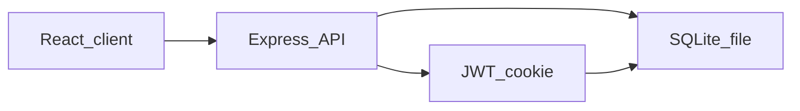

# Implementation Plan

**Product:** Employee Support Ticket Management Application

**Author:** Vennela Varadhi

The application lives in this repository. MongoDB is not installed, so persistence uses Node.js `node:sqlite` with `--experimental-sqlite`.

Shared decisions:

- Validation helpers live in `server/src/validators.js`.
- Role checks live in `server/src/middleware/auth.js`.
- Routes are mounted from `server/src/app.js` so tests can call the app without listening.
- Seed data lives in `server/src/seed.js`.

## Steps

### 1. Project setup and folder structure

- **Files:** `client/` (Vite React), `server/src/`, `server/data/.gitkeep`, `.gitignore`, `.env.example`, root `package.json` scripts `dev`, `start`, `seed`, and `test`. Server and test scripts pass `--experimental-sqlite`.
- **Expected output:** `npm run dev` serves the API and the React shell.
- **Dependencies:** none.
- **Testing:** both processes start and `GET /api/health` returns ok.

### 2. Database and data models

- **Files:** `server/src/db.js`, `server/src/seed.js`.
- **Expected output:** SQLite tables `users`, `tickets`, and `comments`, plus Ravi, Admin, and the five sample tickets.
- **Dependencies:** step 1.
- **Testing:** seed is repeatable and does not duplicate users.

### 3. Authentication and user roles

- **Files:** `server/src/routes/auth.js`, `server/src/middleware/auth.js`, client login page and session context.
- **Expected output:** `POST /api/auth/login`, `POST /api/auth/logout`, `GET /api/auth/me`. Ravi and Admin can sign in, and the UI knows the role.
- **Dependencies:** step 2.
- **Testing:** success, wrong password, missing cookie.

### 4. Employee ticket creation and listing

- **Files:** `server/src/routes/tickets.js`, employee dashboard, create form, table, search, category filter.
- **Expected output:** `POST /api/tickets` and `GET /api/tickets`. Ravi creates a ticket and sees only his tickets.
- **Dependencies:** step 3.
- **Testing:** create, own list, search.

### 5. Support staff dashboard

- **Files:** dashboard summary on the same list API, summary cards in the client.
- **Expected output:** Admin sees all five sample tickets and counts by status.
- **Dependencies:** step 4.
- **Testing:** Admin's visible count is five. Ravi's count is only his tickets.

### 6. Ticket status management

- **Files:** `PATCH /api/tickets/:id/status`, status control on the details page for support staff.
- **Expected output:** status persists, including on a Closed ticket, and `updated_at` changes.
- **Dependencies:** step 5.
- **Testing:** Admin success, employee 403, invalid status 400.

### 7. Ticket editing and validation

- **Files:** `PATCH /api/tickets/:id`, details form, `server/src/validators.js`.
- **Expected output:** the owner and Admin can edit a ticket that is not Closed. Both are rejected when it is Closed. Empty and over-long titles are rejected.
- **Dependencies:** step 6.
- **Testing:** acceptance cases in SPEC.md section 8.

### 8. Ticket comments

- **Files:** `GET` and `POST /api/tickets/:id/comments`, comment box on the details page.
- **Expected output:** author name and timestamp are shown. An empty body is rejected. Another employee receives 403. Comments work on Closed tickets.
- **Dependencies:** step 7.
- **Testing:** closed-ticket comment and unauthorized comment.

### 9. UI improvements and responsive design

- **Files:** client layout, sidebar, summary cards, badges, filters, and CSS.
- **Expected output:** a layout that works on a narrow viewport and on a desktop width.
- **Dependencies:** steps 4 to 8.
- **Testing:** browser pass of login, create, filter, details, comment, and status change as both roles.

### 10. Testing and bug fixing

- **Files:** `server/tests/api.test.js`, `TEST_RESULTS.md`, `DEFECT_LOG.md`.
- **Expected output:** the 14 required scenarios run against a temporary SQLite file, with real results recorded.
- **Dependencies:** steps 1 to 9.
- **Testing:** run the file. If a genuine defect appears, reproduce it, fix it, re-run, and document it. Do not invent a defect. If none is found, `DEFECT_LOG.md` records what was exercised.

### 11. README and documentation

- **Files:** `README.md`, `CODE_REVIEW.md`.
- **Expected output:** installation, environment, sample login, test instructions, folder structure, and an honest split between generated work, review, and executed tests.
- **Dependencies:** step 10.
- **Testing:** commands in the README match the scripts that were actually run.

## Git checkpoints

Commits stay in this repository. Nothing is pushed unless Vennela asks.

1. Add product specification and implementation plan. This commit happens before feature code.
2. Initial project setup.
3. Implement authentication and user roles.
4. Add ticket management features.
5. Add comments functionality.
6. Fix identified defect, or record that none was found.
7. Add automated tests.
8. Complete documentation.

The specification commit is first in time so the approved spec is in Git before application code. The setup commit follows it.
